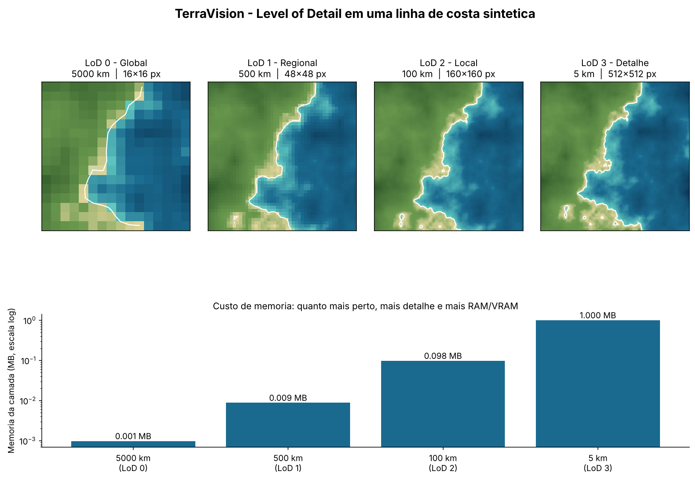
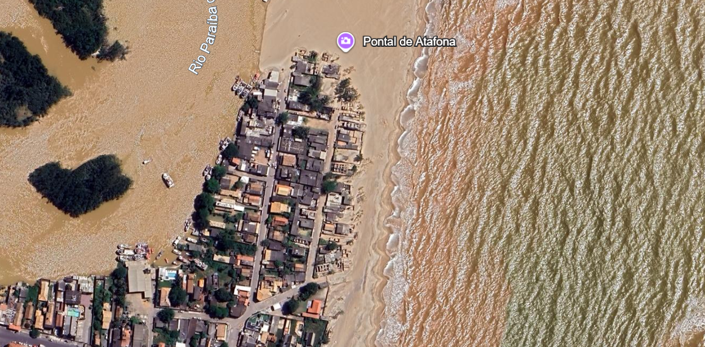

# TerraVision vs. Google Earth
### Como um mapa 3D decide o que mostrar na costa

**Aluno:** Eduardo Gabriel da Silva Kotowski · **Nº:** 3 · **Turma:** 3°D - DS
**Tema 3:** Regiões Litorâneas e Dinâmica Oceânica (Linha de Costa/Erosão)
**Disciplinas integradas:** Ciência de Dados & Computação Gráfica



---

## Índice

1. [Sobre o projeto](#sobre-o-projeto)
2. [Como rodar](#como-rodar)
3. [Como o código funciona](#como-o-código-funciona)
4. [Resultados](#resultados)
5. [Análise de Computação Gráfica e UX/UI](#análise-de-computação-gráfica-e-uxui)
6. [Conexão forense](#conexão-forense)
7. [Limitações](#limitações)
8. [Referências](#referências)

---

## Sobre o projeto

Abre o Google Earth e dá zoom numa praia. Parece que o planeta inteiro está guardado ali em alta definição, né? Só que nenhum computador aguenta carregar tudo isso de uma vez. O truque é simples: o sistema carrega **apenas o que a câmera consegue enxergar naquele instante**. James Clark já descrevia essa ideia de **Level of Detail (LoD)** nos anos 70 (CLARK, 1976). Décadas depois, o pessoal do SRI International levou esse mesmo conceito para o TerraVision, permitindo voar sobre terrenos gigantes sem travar a máquina (REDDY et al., 1999).

Fiquei com o **litoral** como tema neste trabalho, e ele escancara qualquer queda de qualidade. A linha entre a terra e o mar faz curvas o tempo todo, então basta baixar a resolução para a praia virar uma escada de pixels quadrados.

Para testar isso na prática, peguei um caso real: o **Pontal de Atafona**, em São João da Barra (RJ), bem na foz do Rio Paraíba do Sul. A erosão costeira castiga aquela região há anos, e o mar já engoliu ruas e casas inteiras dos moradores locais (VIANA; FARIA, 2021).

Meu script pega a captura que fiz desse trecho no Google Earth e simula uma câmera descendo de 5.000 km até 5 km de altitude. Tudo roda numa janela interativa onde você dá zoom, arrasta o mapa e vê as ondas se mexendo na água.

---

## Como rodar

Você só precisa do Python 3 instalado. Abra o terminal na pasta do projeto e rode:

```bash
pip install numpy matplotlib
python script.py
```

> Deixe o arquivo `imagem_costa.png` na **mesma pasta** do `script.py`. Se ele faltar, o código avisa no terminal e gera uma costa fictícia para o programa não quebrar.

Assim que você executar, o terminal imprime os testes de validação, salva o painel `renderizacao_lod.png` e abre a janela interativa.

### Controles da janela

| Ação | Como fazer |
|---|---|
| Aproximar ou afastar a câmera | Scroll do mouse (ou teclas `+` e `-`) |
| Mover a imagem | Arrastar com o botão esquerdo (ou setas do teclado) |
| Pausar ou retomar as ondas | `Espaço` |
| Ver onde o programa detectou água | `M` |
| Ajustar a detecção de água | `[` e `]` |
| Voltar à visão inicial | `R` |
| Salvar uma captura da tela | `S` (cria `captura_lod.png`) |
| Sair | `Q` |

No canto da janela você acompanha em tempo real a altitude atual, o nível de LoD ativo e o tamanho da camada na memória.

---

## Como o código funciona

O `script.py` segue seis passos diretos:

**1. Carrega a imagem.** O programa lê o arquivo `imagem_costa.png` e transforma tudo em uma matriz RGB.

**2. Escolhe o nível de detalhe pela altitude.** Aqui mora a lógica principal do trabalho. A função `nivel_para_altitude()` usa estruturas `if/elif/else` para decidir quanta informação carregar, e a `carregar_camada_satelite()` reduz a imagem de acordo com essa regra:

| Altitude da câmera | Nível | Redução da imagem |
|---|---|---|
| ≥ 1000 km | LoD 0 (Global) | 1/64 (cada bloco de 64×64 px vira 1 pixel) |
| 200 a 999 km | LoD 1 (Regional) | 1/16 |
| 30 a 199 km | LoD 2 (Local) | 1/4 |
| < 30 km | LoD 3 (Detalhe) | Original, sem redução |

**3. Valida a altitude.** Se alguém passar zero, número negativo, texto ou valores acima de 40.000 km, o código dispara um `ValueError` explicando o erro. O programa captura essa falha e continua rodando sem travar.

**4. Liga o zoom à altitude.** Sem zoom, a câmera fica a 5.000 km. No zoom máximo, desce até 5 km. Usei uma escala logarítmica para que cada giro no scroll do mouse mude a altitude numa proporção constante, trocando o LoD automaticamente quando cruza os limites da tabela. Para evitar engasgos, o script calcula todas as versões reduzidas da imagem uma única vez logo que abre, seguindo a mesma lógica das pirâmides de textura (WILLIAMS, 1983).

**5. Anima as ondas.** O algoritmo identifica a água pela cor, filtrando onde o azul vence o vermelho sem confundir com vegetação. Só nessa área ele aplica um leve deslocamento ondulado nos pixels e varia o brilho a cada quadro para simular o reflexo do sol. Enquanto isso, a areia e a terra ficam totalmente paradas.

**6. Renderiza na tela.** Por fim, o script abre a janela interativa, salva o painel comparando os 4 níveis lado a lado e plota o gráfico de consumo de memória.

---

## Resultados


*Figura 1: saída gerada pelo `script.py`. Na parte de cima aparece a mesma imagem carregada nos quatro níveis de LoD. Embaixo, o gráfico mostra a memória consumida por cada camada em escala logarítmica.*

Olhando o resultado, algumas coisas saltam aos olhos:

- **LoD 0:** a costa vira um borrão de quadrados gigantes. Você ainda distingue terra, mar e a mancha de sedimentos na água, mas para por aí.
- **LoD 1 e 2:** a foz do rio, a faixa de areia e o recorte do litoral começam a ganhar contorno.
- **LoD 3:** entra a imagem original limpa, revelando as ondas, as ruas e as casas atingidas pela erosão.
- **Na janela interativa:** de longe, as ondas parecem só um brilho suave piscando sobre blocos grandes. Quando você aproxima, elas ganham desenho próprio. O detalhe fino simplesmente não existe nos níveis mais baixos.
- **O peso na memória:** o LoD 3 consome cerca de **4.000 vezes mais memória** que o LoD 0, já que 64 × 64 equivalem a 4.096 pixels para cada pixel do nível global. Carregar o planeta inteiro nessa qualidade travaria qualquer máquina, e é exatamente aí que o `if/elif/else` salva o sistema.

---

## Análise de Computação Gráfica e UX/UI

### 1. Costurando imagens de satélite no litoral (stitching e texturas)

Colar fotos de satélite no mar dá muito mais dor de cabeça do que em terra firme. Três problemas complicam esse processo:

- **Reflexo do sol na água (*specular glare*).** Dependendo do ângulo em que o satélite passa, o mar estoura em manchas brilhantes. Duas fotos vizinhas tiradas em horários diferentes acabam com tons bem distintos na água, deixando a emenda visível.
- **O mar nunca para.** Maré, ondas e espuma mudam o desenho da faixa de areia de uma captura para outra. O algoritmo precisa misturar as bordas (*blending*) para a costura não virar um corte seco no meio da praia.
- **Gradiente de profundidade e sedimentos.** O azul profundo do oceano vira turquesa perto da areia, e a água fica barrenta na boca dos rios. Se o sistema não suavizar essas passagens de cor, surgem faixas artificiais e falhas de compressão.

### 2. Design da interface e Leis da Gestalt

Explorando o litoral no Google Earth, dá para notar duas leis da Gestalt guiando nossa visão o tempo todo (WERTHEIMER, 1923; KOFFKA, 1935):

- **Figura-fundo:** o oceano ocupa grande parte da tela com uma cor uniforme e funciona como fundo. Isso joga todo o destaque para o contorno do continente, as ruas e a linha da praia.
- **Continuidade:** a linha de costa forma um traço contínuo que puxa o olhar naturalmente. Você acompanha o desenho do litoral sem esforço enquanto procura pontos de erosão.

O contraste forte entre o azul do mar e o claro da areia também orienta onde dar zoom. Conforme você desce a câmera, a textura das ondas e o relevo aparecem na tela, avisando visualmente que o programa carregou um nível maior de detalhe.

### 3. Evidência visual no Google Earth



*Figura 2: captura do Google Earth no Pontal de Atafona (São João da Barra, RJ). A imagem mostra a foz do Rio Paraíba do Sul, a pluma de sedimentos no mar, as ondas e o avanço da água sobre a área urbana.*

Atafona ilustra bem esse tema porque você enxerga a erosão a olho nu, com o mar invadindo ruas e construções. É o tipo de cenário em que carregar níveis altos de LoD faz diferença real para analisar o que acontece na costa.

---

## Conexão forense

No Episódio 4, a perícia técnica no tribunal gira em torno de uma ideia central: renderizar mapas 3D em tempo real exige **condicionais bem pensadas**. A função `carregar_camada_satelite()` aplica exatamente essa lógica ao filtrar a resolução antes de ocupar RAM ou VRAM. Sem esse filtro, carregar oceanos e litorais do mundo inteiro esgotaria a memória na hora. O Google Earth moderno trabalha sob o mesmo princípio, apenas escalando isso para dezenas de níveis e terabytes de dados reais.

---

## Limitações

Vale deixar claro o que este protótipo **não** faz:

- **Simulação de LoD.** O código reduz a *mesma* imagem calculando a média de blocos de pixels. No Google Earth real, cada nível puxa fotos de satélite diferentes com detalhes novos, em vez de apenas borrar a foto original.
- **Detecção de água por cor.** Essa regra funciona como uma estimativa simples. Em trechos barrentos, como a foz do rio, o filtro pode ignorar parte da água, mas você ajusta a sensibilidade na hora com `[` e `]` conferindo o resultado na tecla `M`.
- **Ondas visuais.** O movimento da água usa deslocamento de pixels e variação de brilho, sem simular a física real das marés.
- **Limites de altitude.** Escolhi os patamares de 1000, 200 e 30 km especificamente para facilitar a demonstração na janela.
- **Cálculo de memória.** O gráfico estima o peso considerando 4 bytes por pixel numa camada RGBA de 8 bits.

---

## Referências

CLARK, James H. Hierarchical geometric models for visible surface algorithms. **Communications of the ACM**, v. 19, n. 10, p. 547–554, out. 1976. DOI: 10.1145/360349.360354.

HARRIS, Charles R. et al. Array programming with NumPy. **Nature**, v. 585, p. 357–362, 2020. DOI: 10.1038/s41586-020-2649-2.

HUNTER, John D. Matplotlib: a 2D graphics environment. **Computing in Science & Engineering**, v. 9, n. 3, p. 90–95, 2007. DOI: 10.1109/MCSE.2007.55.

KOFFKA, Kurt. **Principles of Gestalt Psychology**. New York: Harcourt, Brace, 1935.

LUEBKE, David et al. **Level of Detail for 3D Graphics**. San Francisco: Morgan Kaufmann, 2003.

REDDY, Martin; LECLERC, Yvan; IVERSON, Lee; BLETTER, Nat. TerraVision II: visualizing massive terrain databases in VRML. **IEEE Computer Graphics and Applications**, v. 19, n. 2, p. 30–38, mar./abr. 1999. DOI: 10.1109/38.749120.

VIANA, Leandro Fernandes; FARIA, Teresa de Jesus Peixoto. Moinho ambiental: dinâmicas adaptativas na Foz do Rio Paraíba do Sul. **Vértices** (Campos dos Goitacazes), v. 23, n. 1, 2021. Disponível em: https://www.redalyc.org/journal/6257/625768606009/625768606009.pdf.

WERTHEIMER, Max. Untersuchungen zur Lehre von der Gestalt II. **Psychologische Forschung**, v. 4, p. 301–350, 1923.

WILLIAMS, Lance. Pyramidal parametrics. In: SIGGRAPH '83: Proceedings of the 10th Annual Conference on Computer Graphics and Interactive Techniques. New York: ACM, 1983. p. 1–11.