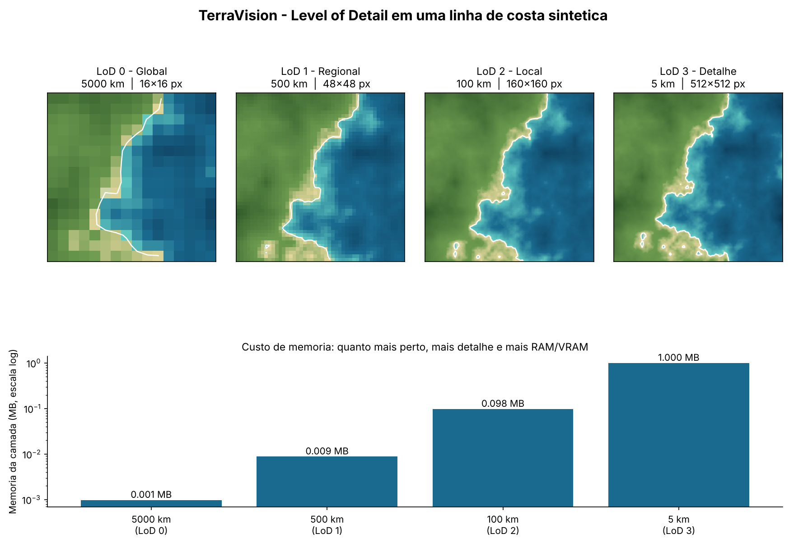
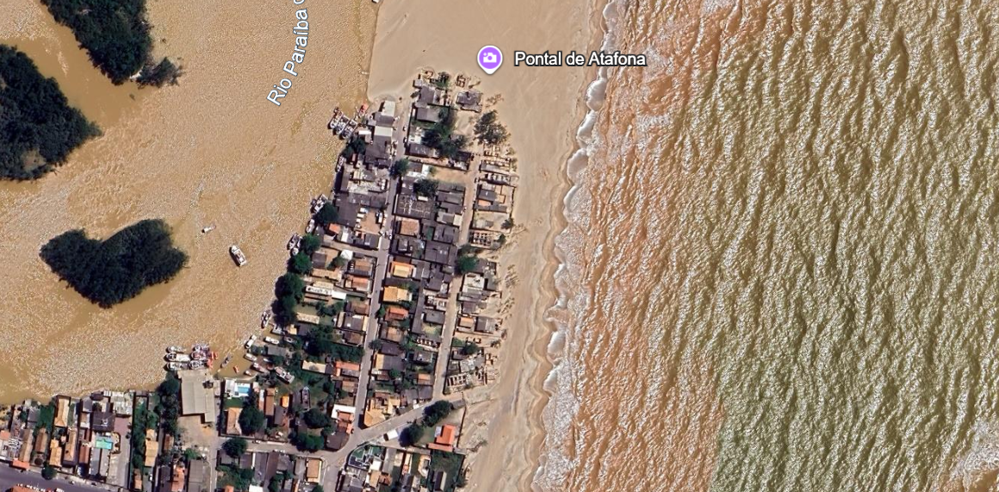

# TerraVision vs. Google Earth
### Como um mapa 3D decide o que mostrar na costa

**Aluno:** Eduardo Gabriel da Silva Kotowski · **Nº:** 3 · **Turma:** 3°D – DS
**Tema 3:** Regiões Litorâneas e Dinâmica Oceânica (Linha de Costa/Erosão)
**Disciplinas integradas:** Ciência de Dados & Computação Gráfica



---

## Sumário

1. [Sobre o projeto](#sobre-o-projeto)
2. [Como rodar](#como-rodar)
3. [Como o código funciona](#como-o-código-funciona)
4. [Resultados](#resultados)
5. [Análise de Computação Gráfica e UX/UI](#análise-de-computação-gráfica-e-uxui)
6. [Conexão forense](#conexão-forense)
7. [Limitações](#limitações)
8. [Histórico de commits](#histórico-de-commits)
9. [Referências](#referências)

---

## Sobre o projeto

Quando a gente abre o Google Earth e dá zoom em uma praia, parece que o programa tem a Terra inteira em alta resolução guardada em algum lugar. Só que isso não cabe na memória de nenhum computador. O truque é carregar **apenas o detalhe que a câmera consegue enxergar naquele momento**. Essa técnica se chama **Level of Detail (LoD)**, ou nível de detalhe, e foi proposta já nos anos 70 por Clark (1976). O TerraVision, desenvolvido pelo SRI International, aplicou a mesma ideia para navegar por terrenos gigantes de forma contínua (REDDY et al., 1999).

Eu escolhi a **costa** porque ela deixa a diferença entre os níveis muito evidente: a linha entre terra e mar é cheia de curvas, e basta uma redução de resolução para ela virar uma escada de quadrados.

Como caso real, usei o **Pontal de Atafona**, em São João da Barra (RJ), na foz do Rio Paraíba do Sul. É um dos lugares do Brasil onde a erosão costeira mais afetou a área urbana, e os moradores da "linha de frente" convivem com o avanço do mar sobre as casas (VIANA; FARIA, 2021).

O programa que fiz carrega a minha captura de tela do Google Earth desse local, simula uma câmera descendo de 5000 km até 5 km de altitude e **renderiza o resultado em uma janela interativa**, com zoom, arrastar e ondas se movendo na água.

---

## Como rodar

Você precisa do Python 3 instalado. No terminal, dentro da pasta do projeto:

```bash
pip install numpy matplotlib
python script.py
```

> O arquivo `imagem_costa.png` precisa estar na **mesma pasta** do `script.py`. Se não estiver, o programa avisa e usa uma costa fictícia no lugar, para não quebrar.

O terminal mostra os testes de validação, o programa salva o painel `renderizacao_lod.png` e abre a janela interativa.

### Controles da janela

| Ação | Como fazer |
|---|---|
| Aproximar / afastar a câmera | Scroll do mouse (ou teclas `+` e `-`) |
| Mover a imagem | Arrastar com o botão esquerdo (ou setas do teclado) |
| Pausar / retomar as ondas | `Espaço` |
| Ver onde o programa detectou água | `M` |
| Ajustar a detecção de água | `[` e `]` |
| Voltar à visão inicial | `R` |
| Salvar uma captura da tela | `S` (cria `captura_lod.png`) |
| Sair | `Q` |

O canto da tela mostra, em tempo real, a altitude, o nível de LoD e o tamanho da camada carregada.

---

## Como o código funciona

O `script.py` faz seis coisas, nesta ordem:

**1. Carrega a imagem.** Lê o `imagem_costa.png` como uma matriz de cores (RGB).

**2. Escolhe o nível de detalhe pela altitude.** É o coração do trabalho. A função `nivel_para_altitude()` usa `if/elif/else` para decidir quanto detalhe carregar, e a `carregar_camada_satelite()` usa essa decisão para reduzir a imagem:

| Altitude da câmera | Nível | Redução da imagem |
|---|---|---|
| ≥ 1000 km | LoD 0 – Global | 1/64 (cada bloco de 64×64 px vira 1 pixel) |
| 200 a 999 km | LoD 1 – Regional | 1/16 |
| 30 a 199 km | LoD 2 – Local | 1/4 |
| < 30 km | LoD 3 – Detalhe | original, sem redução |

**3. Valida a altitude.** Valor negativo, zero, texto ou acima de 40 000 km gera um `ValueError` com mensagem clara. O erro é tratado e o programa continua rodando em vez de travar.

**4. Liga o zoom à altitude.** Sem zoom, a câmera está a 5000 km. No zoom máximo, a 5 km. A conversão é logarítmica, então cada "rolada" do mouse muda a altitude por um fator constante, e o nível de LoD troca sozinho quando a altitude cruza os limites da tabela. Para o programa ficar fluido, as versões reduzidas da imagem são calculadas uma única vez no início, no mesmo espírito das pirâmides de resolução usadas em texturas (WILLIAMS, 1983).

**5. Anima as ondas.** O programa detecta a água pela cor (onde o azul domina o vermelho e não é vegetação) e só nessa região aplica, a cada quadro, um pequeno deslocamento ondulado dos pixels e um brilho que varia no tempo, imitando o reflexo do sol. Terra e areia ficam paradas.

**6. Renderiza.** Abre a janela interativa e salva o painel com os 4 níveis lado a lado e o gráfico de memória.

---

## Resultados


)

*Figura 1: saída do `script.py`. Em cima, a 
mesma imagem carregada em quatro níveis de LoD. Embaixo, a memória usada por cada camada (escala logarítmica).*

O que dá para observar:

- **LoD 0:** a imagem vira um mosaico de quadrados grandes. Dá para separar terra, mar e a cor da pluma de sedimentos, e só.
- **LoD 1 e 2:** a foz do rio, a faixa de areia e o desenho da costa começam a aparecer.
- **LoD 3:** é a imagem original, onde se veem as ondas, as ruas e as construções afetadas pela erosão.
- **Na janela interativa:** de longe, as ondas são só um brilho suave sobre os blocos. De perto, elas ganham forma. O detalhe fino da superfície simplesmente não existe nos níveis mais grosseiros.
- **O custo:** o LoD 3 usa cerca de **4000 vezes mais memória** que o LoD 0 (64 × 64 = 4096 pixels para cada pixel do nível global). Carregar esse nível para o planeta inteiro seria inviável, e é por isso que o `if/elif/else` importa tanto.

---

## Análise de Computação Gráfica e UX/UI

### 1. Costurando imagens de satélite no litoral (stitching e texturas)

Juntar fotos de satélite é mais difícil no mar do que em terra firme, por três motivos:

- **Reflexo do sol na água (*specular glare*).** Dependendo do ângulo do satélite, a água fica com manchas brilhantes. Duas fotos vizinhas, tiradas em horários diferentes, podem ter cores bem diferentes no mesmo mar, e a emenda aparece.
- **A água não fica parada.** Maré, ondas e espuma mudam a faixa de areia visível de uma foto para outra. É preciso suavizar a transição (*blending*) para a emenda não virar uma linha reta no meio da praia.
- **Gradiente de profundidade e sedimentos.** O azul-escuro do mar profundo vai virando turquesa perto da costa, e nas fozes de rios a água fica turva. Se a transição de cores for mal feita, aparecem faixas e artefatos de compressão.

### 2. Design da interface e Leis da Gestalt

Navegando pelo Google Earth no litoral, percebi duas leis da Gestalt em ação (WERTHEIMER, 1923; KOFFKA, 1935):

- **Figura-fundo:** o mar, grande e de cor uniforme, funciona como fundo. Por isso o contorno do continente, a malha urbana e a linha de praia se destacam como figura.
- **Continuidade:** a linha de costa é um traçado contínuo e o olhar segue ela naturalmente. Isso ajuda a "caminhar" pelo litoral procurando pontos de erosão.

O contraste forte entre mar e areia também guia o zoom. Conforme me aproximo, a textura das ondas e o relevo aparecem, e isso me avisa que o programa carregou um nível de detalhe maior. A própria imagem funciona como feedback para o usuário.

### 3. Evidência visual no Google Earth



*Figura 2: captura de tela do Google Earth no Pontal de Atafona (São João da Barra, RJ). Dá para ver a foz do Rio Paraíba do Sul, a pluma de sedimentos na água, as ondas e o avanço da erosão sobre a área urbana.*

Atafona é um bom exemplo para o tema porque a erosão é visível a olho nu: o mar já avançou sobre ruas e casas. É o tipo de caso em que ver a costa com detalhe, nos níveis de LoD mais altos, faz diferença real para estudar a dinâmica do litoral.

---

## Conexão forense

No Episódio 4, durante a perícia do código no tribunal, o ponto central era que carregar dados geoespaciais em tempo real depende de **condicionais eficientes**. É exatamente o que o `carregar_camada_satelite()` faz: antes de gastar RAM/VRAM, ele decide qual resolução realmente precisa ser carregada. Sem isso, renderizar oceanos e costas do planeta inteiro estrangularia a memória. O Google Earth atual segue a mesma lógica, só que com muito mais níveis e dados reais.

---

## Limitações

Prefiro deixar claro o que o projeto **não** faz:

- **O LoD é simulado.** Eu reduzo a *mesma* imagem tirando a média de blocos de pixels. No Google Earth de verdade, cada nível é uma imagem de satélite diferente, com detalhe novo, e não a mesma foto borrada.
- **A água é detectada pela cor.** É uma estimativa. Em trechos barrentos ou marrons, como a foz do rio, o programa pode não reconhecer a água. Dá para corrigir na hora com `[` e `]`, conferindo com `M`.
- **As ondas são um efeito visual** (deslocamento + brilho), não uma simulação física do mar.
- **Os limites de altitude** (1000, 200 e 30 km) foram escolhidos por mim para a demonstração.
- **O consumo de memória** é uma estimativa simples: 4 bytes por pixel, camada RGBA de 8 bits.

---


- `docs(readme): reescrita do README com resultados, limitacoes e referencias`

---

## Referências

CLARK, James H. Hierarchical geometric models for visible surface algorithms. **Communications of the ACM**, v. 19, n. 10, p. 547–554, out. 1976. DOI: 10.1145/360349.360354.

HARRIS, Charles R. et al. Array programming with NumPy. **Nature**, v. 585, p. 357–362, 2020. DOI: 10.1038/s41586-020-2649-2.

HUNTER, John D. Matplotlib: a 2D graphics environment. **Computing in Science & Engineering**, v. 9, n. 3, p. 90–95, 2007. DOI: 10.1109/MCSE.2007.55.

KOFFKA, Kurt. **Principles of Gestalt Psychology**. New York: Harcourt, Brace, 1935.

LUEBKE, David et al. **Level of Detail for 3D Graphics**. San Francisco: Morgan Kaufmann, 2003.

REDDY, Martin; LECLERC, Yvan; IVERSON, Lee; BLETTER, Nat. TerraVision II: visualizing massive terrain databases in VRML. **IEEE Computer Graphics and Applications**, v. 19, n. 2, p. 30–38, mar./abr. 1999. DOI: 10.1109/38.749120.

VIANA, Leandro Fernandes; FARIA, Teresa de Jesus Peixoto. Moinho ambiental: dinâmicas adaptativas na Foz do Rio Paraíba do Sul. **Vértices** (Campos dos Goitacazes), v. 23, n. 1, 2021. Disponível em: https://www.redalyc.org/journal/6257/625768606009/625768606009.pdf.

WERTHEIMER, Max. Untersuchungen zur Lehre von der Gestalt II. **Psychologische Forschung**, v. 4, p. 301–350, 1923.

WILLIAMS, Lance. Pyramidal parametrics. In: SIGGRAPH '83: Proceedings of the 10th Annual Conference on Computer Graphics and Interactive Techniques. New York: ACM, 1983. p. 1–11.
